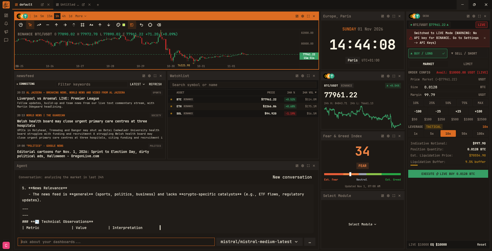

<div align="center">


<h1>FinTer</h1>

<p><strong>A native market terminal for people who read charts for a living.</strong></p>

<p>Live crypto markets, a real charting engine, and a workspace that remembers where you left it — built in Rust on GPUI.</p>

<p>
  
  
  
  
</p>

</div>

> **Early development.** APIs, storage formats, and UI behavior may change. Guest Mode is fully usable offline; cloud features are optional and require a compatible backend.

## The workspace

<div align="center">
  
  <br />
  <sub><em>Live charting, market panels, and watchlists arranged in a resizable pane grid.</em></sub>
</div>

## Why FinTer

Most market tools ask you to choose between a browser tab that eats your RAM and a terminal that eats your afternoon. FinTer is a native desktop application: it starts fast, renders smoothly, and keeps your layout, symbols, and indicators on disk.

- **Local-first by default** — Guest Mode runs without an account or a backend; layouts and settings persist locally.
- **Optional cloud sync** — sign in only when you want dashboards and settings on more than one machine.
- **Yours to inspect** — MIT-licensed Rust, from the chart engine to the keyring integration.

## What's inside

| **Charting** | **Market data** |
| --- | --- |
| Candlesticks and Heikin Ashi, pan, zoom, crosshair, volume, exchange-aware price formatting, timezone-aware axes, resizable indicator sub-panes, and a built-in study library. | Live OHLCV over WebSocket with history and reconnect handling, order books, trade tape, tickers, watchlists, market cap, Fear & Greed, and a news feed. |

| **Workspace** | **Account & updates** |
| --- | --- |
| A resizable pane grid with dashboard modules, saved layouts, a dashboard manager, and local persistence for guest sessions. | Optional sign-in with cloud sync, tokens in the OS keyring, and verified HTTPS updates with SHA-256 metadata checks. |

### Indicators

Studies route to the main chart or to their own resizable sub-pane.

| Trend | Momentum | Volatility | Volume |
| --- | --- | --- | --- |
| MA, EMA, SMA, BBI, SAR, TRIX | MACD, KDJ, RSI, WR, CCI, ROC, MTM, BIAS, PSY | BOLL, AVP | VOL, OBV, PVT |

## Quick start

**Requirements:** a stable Rust toolchain with Cargo, plus the platform libraries GPUI needs.

<details>
<summary><strong>Ubuntu / Debian dependencies</strong></summary>

```sh
sudo apt-get update
sudo apt-get install -y \
  libxkbcommon-dev libxkbcommon-x11-dev \
  libwayland-dev libvulkan-dev \
  libxcb-render0-dev libxcb-shape0-dev libxcb-xfixes0-dev \
  libssl-dev pkg-config
```

</details>

```sh
git clone https://github.com/coin-watch/FinTer.git
cd FinTer
cargo run --release
```

Verify a checkout before sending a change:

```sh
cargo test --workspace
cargo fmt --check
cargo clippy -- -D warnings
```

## Connect a backend (optional)

FinTer runs in **Guest Mode** without a backend: it persists your layout and settings locally and shows clear empty states when market data is unavailable. Once you sign in, the native client defaults to the hosted CoinWatch staging backend (`https://staging.coinwat.ch`) so account, dashboard, preset, and profile data load without extra setup.

Point it at a different backend in **Settings → Network & Server**, or set the environment variable before launch:

```sh
FINTER_API_URL="http://localhost:5173" cargo run
```

A locally configured endpoint is preserved across restarts and is not cleared by a null `serverUrl` in the shared server-side settings record. Legacy builds that saved `https://coinwat.ch` (the marketing site) as the API origin are migrated automatically to the hosted API origin, so sign-in behaves the same on Linux, macOS, and Windows.

| Variable | Purpose |
| --- | --- |
| `FINTER_API_URL` | Backend API origin for account features and defaults. |
| `FINTER_REST_URL` | REST market gateway; defaults to the API origin. |
| `FINTER_WS_URL` | WebSocket market stream gateway. |
| `FINTER_NEWS_API_URL` | News article API. |
| `FINTER_NEWS_WS_URL` | News WebSocket stream. |
| `FINTER_VERSION_URL` | HTTPS update metadata; unset disables update checks. CI sets it per channel. |
| `FINTER_BUILD_ID` | Build identifier used to detect same-version channel updates. |

<details>
<summary><strong>Authentication, storage &amp; data separation</strong></summary>

**Transport.** FinTer communicates over TLS (HTTPS/WSS) or local loopback (`http://localhost:*`) only.

**Credentials.** JWTs are stored in the operating system's credential vault through `keyring-rs` — Windows Credential Manager, macOS Keychain, or Linux Secret Service. Plaintext passwords are never persisted to disk.

**Guest and cloud data never share files.**

| | Guest / offline | Cloud account |
| --- | --- | --- |
| Layout | `~/.config/finter/guest_layout.json` | `~/.config/finter/cloud_layout.json` |
| Settings | `~/.config/finter/guest_settings.json` | `~/.config/finter/cloud_settings.json` |
| Credentials | — | OS keyring (`finter/session`) |

Cloud files are cached locally and synchronized with the backend. Logging out restores the guest workspace immediately, without erasing or altering cloud configurations.

Tab preferences (which dashboard tabs open on startup) are local-only and stored in `~/.config/finter/guest_tab_settings.json` and `~/.config/finter/cloud_tab_settings.json`; they are never synced.

</details>

## Privacy & security

FinTer does not ship API keys, application credentials, user data, session tokens, database dumps, compiled artifacts, or vendored dependency build directories. Authentication tokens are obtained at runtime and stored through the OS keyring where available. When a keyring is unavailable, the fallback session file lives in the per-user configuration directory and is restricted to the current user on Unix systems.

Release builds are signed for each platform so operating-system security gates do not block them: macOS builds are signed with a Developer ID, hardened at runtime, notarized, and stapled; Windows builds are Authenticode-signed and timestamped; Linux AppImages ship AppStream metadata and an optional GPG signature. See [Platform security and release signing](docs/PLATFORM-SECURITY.md) for the required secrets, verification commands, and the release signing policy.

Do not commit `.env` files, credentials, private keys, local session files, or generated build output. See [`.gitignore`](.gitignore).

## Project layout

| Path | Contents |
| --- | --- |
| `src/` | Application, chart, UI, networking, authentication, and persistence code. |
| `assets/` | Application icons, fonts, and UI assets. |
| `gpui-component-patched/` | Patched GPUI component dependency used by the application. |
| `tests/updater/` | Isolated updater verification tests. |
| `scripts/` | Release and publishing helpers. |
| `docs/` | Product and engineering documentation. |

## Release builds

Release automation lives in [`.github/workflows`](.github/workflows). It builds platform binaries, signs them for the target platform, and produces SHA-256 checksums. Publishing update artifacts requires repository-hosted deployment secrets; those values belong in GitHub Actions secrets and must never be committed.

Missing macOS or Windows signing secrets produce a warning and an unsigned build, so forks and staging environments are not blocked. Set the `REQUIRE_SIGNING` repository variable to `true` to make missing credentials a hard failure once production secrets are configured. See [Platform security and release signing](docs/PLATFORM-SECURITY.md) for the full secret list and verification commands.

Before publishing, review the workflow endpoints, artifact names, update metadata URL, and repository permissions for your deployment environment. Update downloads require explicit user action, are size-bounded, and are re-verified against SHA-256 metadata before installation. SHA-256 detects corruption but does not authenticate publishers — treat the configured HTTPS update host as trusted code distribution infrastructure.

## License

FinTer is released under the [MIT License](LICENSE).

<div align="center">
<sub>Built with Rust and GPUI · <a href="https://github.com/coin-watch/FinTer">github.com/coin-watch/FinTer</a></sub>
</div>
